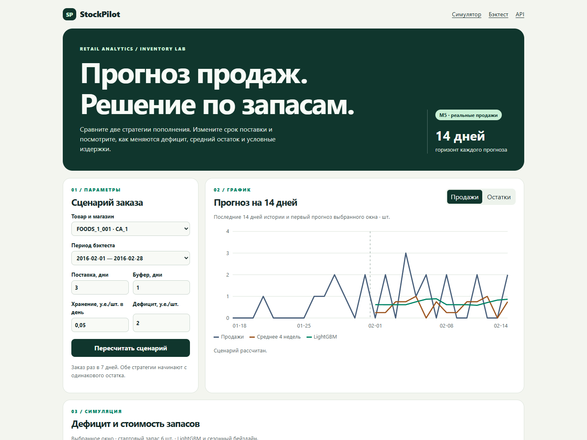
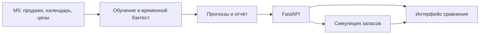

# StockPilot

Прогноз дневных продаж и симулятор пополнения запасов. Выберите товар и магазин, сравните сезонный бейзлайн и LightGBM, затем измените срок поставки и страховой буфер.

**54 пары товар–магазин · 4 отложенных окна · WAPE 88,69% → 81,82% · 187 единиц дефицита меньше в симуляции.**

[Методика и результаты](docs/evaluation.md) · [Метрики JSON](docs/results.json) · [Видеодемо](docs/demo.mp4)



## Запуск

Из каталога проекта:

```bash
docker compose up --build -d --wait
```

Откройте [StockPilot](http://127.0.0.1:8088/) или [Swagger](http://127.0.0.1:8088/docs). Приложение использует локальный снимок `artifacts/snapshot.json`. При его отсутствии доступен явно помеченный синтетический режим.

Для воспроизведения эксперимента на M5:

```bash
docker compose --profile experiment run --build --rm evaluator
docker compose restart app
python -m scripts.smoke --expect-source m5
```

Воспроизведение скачивает архив M5 (~48 МиБ), сверяет SHA‑256, обучает модели на CPU и записывает отчёт и снимок для интерфейса. Команда HTTP-проверки использует стандартную библиотеку Python. Без Docker можно запустить те же шаги в Python 3.14:

```bash
python -m pip install -r requirements-dev.txt
python -m scripts.fetch_m5
python -m scripts.evaluate
python -m pytest -q
python -m uvicorn stockpilot.api:app --port 8088
```

## Как работает



- **Эксперимент.** Одна модель LightGBM на все ряды, прямой прогноз на 14 дней, признаки по доступной истории продаж и цен и по календарю.
- **Симуляция.** Две стратегии заказа с одинаковым стартовым запасом и периодом пересмотра. Изменяются срок поставки, буфер, стоимость хранения и дефицита.
- **API.** `GET /api/catalog` показывает доступные товары и окна, `GET /api/scenario` считает сравнение, `GET /api/report` отдаёт агрегированную оценку.
- **Проверки.** Тесты инвариантов запасов, отсечения будущих данных и API. CI проверяет тесты и Docker-запуск на синтетическом наборе.

Источник — [M5 Forecasting](https://github.com/Mcompetitions/M5-methods), закреплённый архив из [зеркала Nixtla](https://github.com/Nixtla/m5-forecasts/tree/72b8e7fd3b565b3c538adcb1d1a05117d8562d7e/datasets). Архив и снимок с дневными продажами исключены из Git. Графики показывают исторический бэктест. В симуляции продажи используются как приближение спроса, а издержки заданы параметрами сценария.
